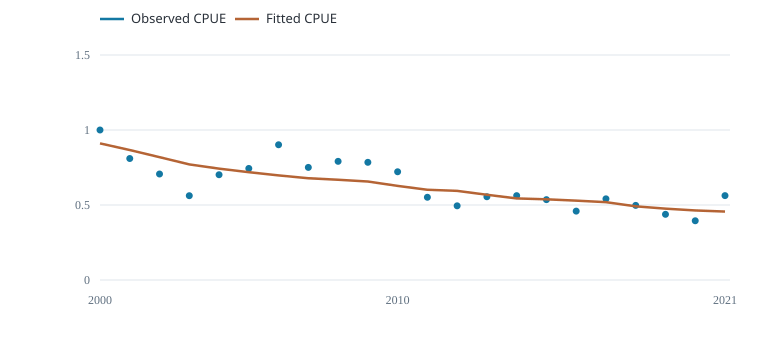
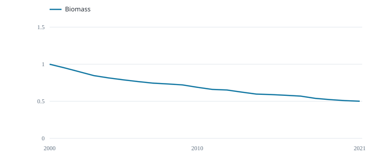

# Assessment A1

Fit the annual CPUE index and carry catch removals through the stock model.

::::: plot-pair
::: section
## Observed and fitted CPUE

{fig-alt="Relative CPUE"}

Relative CPUE
:::

::: section
## Biomass trajectory

{fig-alt="Biomass / carrying capacity"}

Biomass / carrying capacity
:::
:::::

Schaefer model · intrinsic growth 0.25 per year · R/RTMB fit · initial biomass equals carrying capacity.

Points are observed indices; the fitted line follows model biomass. Biomass is relative to the fitted capacity.

  Recorded check       Result
  -------------------- --------
  Biomass recurrence   Pass
  Positive biomass     Pass
  Projected gradient   Pass

These checks do not establish model adequacy.

The selected Fiji fleet index is not a validated stock-wide abundance index. Using it with stock-wide catches is a teaching assumption.
