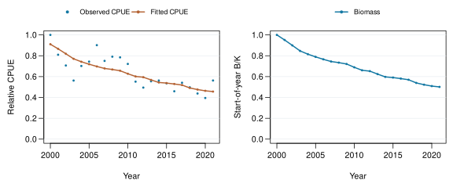

# Assessment A1

**Assessment analyst** · Run 001 · Years 2000–2021

Calculation finished (container exit 0).

<table>
 <thead>
  <tr>
   <th style="text-align:left;"> Fixed r (/y) </th>
   <th style="text-align:left;"> Capacity K (t) </th>
   <th style="text-align:left;"> Catchability q </th>
   <th style="text-align:left;"> Final B/K </th>
  </tr>
 </thead>
<tbody>
  <tr>
   <td style="text-align:left;"> 0.25 </td>
   <td style="text-align:left;"> 1029000 </td>
   <td style="text-align:left;"> 8.847e-07 </td>
   <td style="text-align:left;"> 0.5011 </td>
  </tr>
</tbody>
</table>

**Numerical checks:** Pass. Maximum balance residual 5.821e-11 t (tolerance 9.45e-04 t); projected gradient 1.774e-09 (tolerance 1e-04); active bound: none.

B/K uses each case's carrying capacity. Fitted parameters and next-year biomass pass to management trial preparation.

**Scope:** selected-fleet CPUE and stock-wide catches are combined only to illustrate the workflow.

**Inputs used**

<table>
 <thead>
  <tr>
   <th style="text-align:left;"> Input </th>
   <th style="text-align:left;"> Analyst </th>
   <th style="text-align:left;"> Produced in </th>
  </tr>
 </thead>
<tbody>
  <tr>
   <td style="text-align:left;"> Prepare inputs A </td>
   <td style="text-align:left;"> Assessment analyst </td>
   <td style="text-align:left;"> Run 001 </td>
  </tr>
</tbody>
</table>

---

[Saved results](report-data.json) · [Run record](record.json) · [Code 50412b29](https://github.com/kyuhank/fisheries-workflow-assessment-demo/commit/50412b29afff933601eb2c04ffa56b71702538ac) · [Workflow 2a8dc292](https://github.com/kyuhank/fisheries-workflow-demo/commit/2a8dc292696fa42866b1f28139c23510dc75f140) · Image 9dea950a713b.

Data: WCPFC/SPC public statistics. [Source 1](https://www.wcpfc.int/sites/default/files/2026-04/WCPFC_L_PUBLIC_BY_YY_QTR_FLAG.zip) · [Source 2](https://www.wcpfc.int/sites/default/files/2026-03/YB_WCPFC_2026-02-25.zip).
