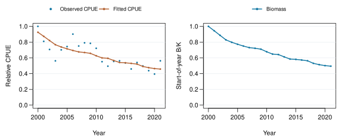

# Assessment A2

<table>
 <thead>
  <tr>
   <th style="text-align:left;"> Fixed r (/y) </th>
   <th style="text-align:left;"> Capacity K (t) </th>
   <th style="text-align:left;"> Catchability q </th>
   <th style="text-align:left;"> Final B/K </th>
   <th style="text-align:left;"> Fit checks </th>
  </tr>
 </thead>
<tbody>
  <tr>
   <td style="text-align:left;"> 0.3 </td>
   <td style="text-align:left;"> 890200 </td>
   <td style="text-align:left;"> 1.039e-06 </td>
   <td style="text-align:left;"> 0.4949 </td>
   <td style="text-align:left;"> Pass </td>
  </tr>
</tbody>
</table>

B/K uses each case's carrying capacity. Checks cover balance, positive biomass, gradient, convergence and boundaries. Case differences are fixed-assumption sensitivities; they do not form an uncertainty interval.

**Scope:** selected Fiji fleet index with stock-wide catches is a teaching assumption; the index is not validated as stock-wide abundance.

---

Run `001`. [Data & full record](report-data.json) · [Code 0b707160](https://github.com/kyuhank/fisheries-workflow-assessment-demo/commit/0b7071600b636b17edacd00ed216af2aff19090a) · [Workflow 9cb9e72e](https://github.com/kyuhank/fisheries-workflow-demo/commit/9cb9e72ec890e86e1f268a23d829e7c2ab8bde93) · Image 9dea950a713b.

Data: WCPFC/SPC public statistics. [Source 1](https://www.wcpfc.int/sites/default/files/2026-04/WCPFC_L_PUBLIC_BY_YY_QTR_FLAG.zip) · [Source 2](https://www.wcpfc.int/sites/default/files/2026-03/YB_WCPFC_2026-02-25.zip).
