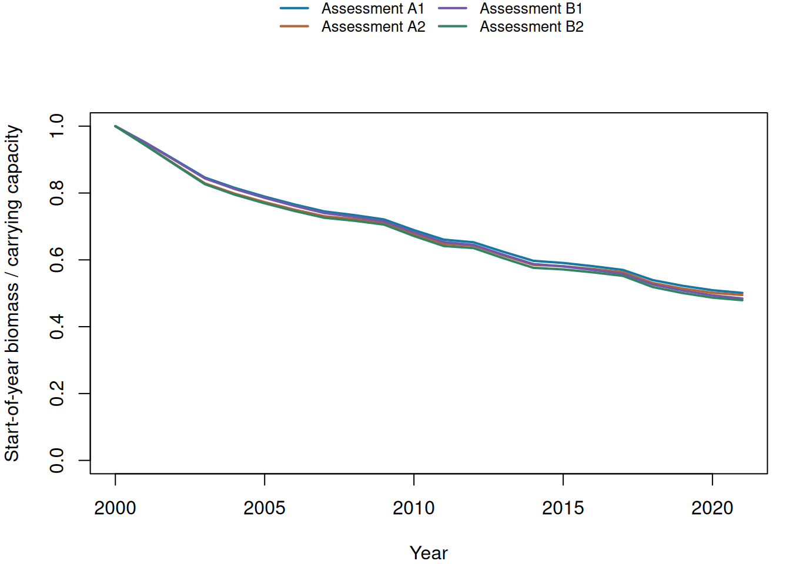

Compare how two CPUE indices and two fixed growth assumptions affect the fitted biomass trajectory.

**Path:** Annual index and catches → fixed-growth Schaefer fit → biomass trajectory.

::: {.cell}

:::

## Biomass comparison

::: {.cell}
::: {.cell-output-display}
{width=672}
:::
:::

Each trajectory shows start-of-year biomass divided by that case's fitted carrying
capacity. The trajectories describe the supplied index, catches and fixed model assumptions.
Differences among cases are not an uncertainty interval or stock-management advice.

### Final annual values and fit checks

::: {.cell}
::: {.cell-output-display}

|Case          | Year|   B/K| Harvest rate|
|:-------------|----:|-----:|------------:|
|Assessment A1 | 2021| 0.501|        0.136|
|Assessment A2 | 2021| 0.495|        0.160|
|Assessment B1 | 2021| 0.484|        0.143|
|Assessment B2 | 2021| 0.479|        0.167|

:::

::: {.cell-output-display}

|Case          | Growth (r)|Balance |Feasible |Gradient |Boundary | Convergence|
|:-------------|----------:|:-------|:--------|:--------|:--------|-----------:|
|Assessment A1 |       0.25|Pass    |Pass     |Pass     |FALSE    |           0|
|Assessment A2 |       0.30|Pass    |Pass     |Pass     |FALSE    |           0|
|Assessment B1 |       0.25|Pass    |Pass     |Pass     |FALSE    |           0|
|Assessment B2 |       0.30|Pass    |Pass     |Pass     |FALSE    |           0|

:::
:::

Convergence, biomass balance and positive-biomass feasibility check the fitted
calculation. They do not establish biological adequacy or validate the CPUE
as a stock-wide abundance measure.

## Methods

**Source coverage:** Fiji fleet; six observed cell–quarter strata, 2000–2022. **Annual catch:** South Pacific albacore nominal catch estimates; all gears and fleets.

The selected Fiji fleet index is not a validated stock-wide abundance index. Using it with stock-wide catches is a teaching assumption.

The analysed series runs from 2000 to
2021. Four cases combine indices A and B with fixed intrinsic growth rates of
0.25 and 0.3
per year. Biomass is the start-of-year, pre-catch state. The annual Schaefer model starts it
at carrying capacity, adds surplus production and subtracts recorded catch in tonnes.
R/RTMB fits carrying capacity by minimising squared log-index residuals within
feasible bounds; log catchability is the mean difference between log index and log biomass. Initial
biomass and growth are assumptions, rather than additional fitted parameters.

## Analysis record

Produced in **Run 001**. Retained inputs keep their original producing runs.

Execution: Local Docker.

Calculation image: `ghcr.io/pacificcommunity/fisheries-workflow@sha256:9dea950a713b87daad728517138bcb664a151f0f5b44a1d5370623734a5bca9d`

[Container package](https://github.com/PacificCommunity/ofp-sam-docker-images/pkgs/container/fisheries-workflow)

[Coordinator source at b343d9d1](https://github.com/kyuhank/fisheries-workflow-demo/commit/b343d9d1c704cfe5f3c4fe61ccef1ae3e679e406)

[Assessment component source at 0e29121c](https://github.com/kyuhank/fisheries-workflow-assessment-demo/commit/0e29121cd0807fb8e058025529c10670befaf702)

Annual values are available in the **Data** tab. Input files, settings, source versions and checksums are available in **Inputs & versions** and the downloaded run. Rendering reads saved results and does not fit models again.
