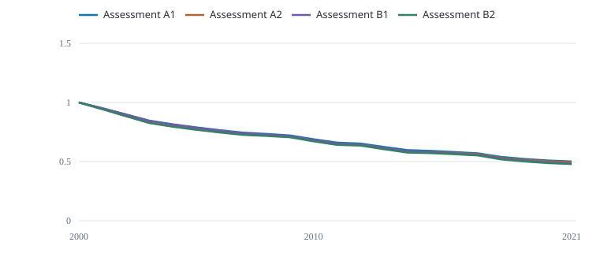

# Compare assessments

Compare the four fitted biomass trajectories.

{fig-alt="Start-of-year biomass / each case's carrying capacity"}

Start-of-year biomass / each case's carrying capacity

Each case has its own fitted carrying capacity. The cases combine two CPUE indices and two fixed growth settings. Their differences are sensitivities, not an uncertainty interval.

  Case            Final year   B / K
  --------------- ------------ --------
  Assessment A1   2021         0.5011
  Assessment A2   2021         0.4949
  Assessment B1   2021         0.4845
  Assessment B2   2021         0.4792

The selected Fiji fleet index is not a validated stock-wide abundance index. Using it with stock-wide catches is a teaching assumption.
