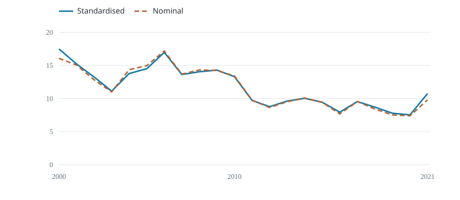

# CPUE analysis B

Fiji longline albacore · 2000--2021 · 132 released fleet--cell--quarter records.

{fig-alt="Fish per 1,000 hooks"}

Fish per 1,000 hooks

Both curves use the same selected rows; 132 used, 0 excluded; no additional effort filter.

Nominal CPUE = 1,000 × annual fish numbers / annual hooks.

B adjusts quarter only and averages predictions over the same six fixed strata. Quarter effects partly confound spatial differences on this support.

Quasipoisson GLM: year + quarter · Arithmetic mean of response-scale predictions with equal fixed stratum weights.

These released strata cover the selected fleet. No confidence intervals or stock-wide abundance validation are supplied.

  Year   Standardised (fish/1,000 hooks)   Nominal (fish/1,000 hooks)
  ------ --------------------------------- ----------------------------
  2000   17.49                             16.08
  2021   10.75                             9.802
