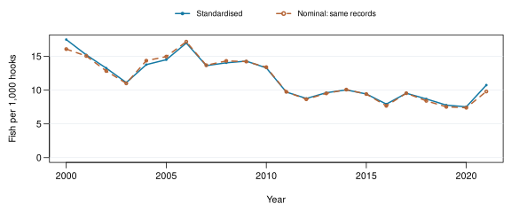

# CPUE analysis B

**CPUE analyst** · Run 001 · Years 2000–2021

Calculation finished (container exit 0).

|Analysis |Rows |Excluded |Converged |Dispersion |Score residual |Final index |
|:--------|:----|:--------|:---------|:----------|:--------------|:-----------|
|B        |132  |0        |Yes       |3011       |1.332e-15      |0.6146      |

Quasipoisson GLM: year + quarter. Nominal = 1,000 × annual fish / annual hooks; both curves use the same selected records. Arithmetic mean of response-scale predictions with equal fixed stratum weights. The relative index passed to assessment equals one in its first year.

**Scope:** Fiji fleet; six observed cell–quarter strata, 2000–2021; aggregate records without vessel effects or confidence intervals.

**Inputs used**

|Input        |Analyst      |Produced in |
|:------------|:------------|:-----------|
|Extract data |Data analyst |Run 001     |

---

Saved files: `report-data.json` · `record.json` · [Code 7d17fc59](https://github.com/kyuhank/fisheries-workflow-cpue-demo/commit/7d17fc5962466cdabc27d17e004bed87136b38bc) · [Workflow 2a8dc292](https://github.com/kyuhank/fisheries-workflow-demo/commit/2a8dc292696fa42866b1f28139c23510dc75f140) · Image 9dea950a713b.

Data: WCPFC/SPC public statistics. [Source 1](https://www.wcpfc.int/sites/default/files/2026-04/WCPFC_L_PUBLIC_BY_YY_QTR_FLAG.zip) · [Source 2](https://www.wcpfc.int/sites/default/files/2026-03/YB_WCPFC_2026-02-25.zip).
