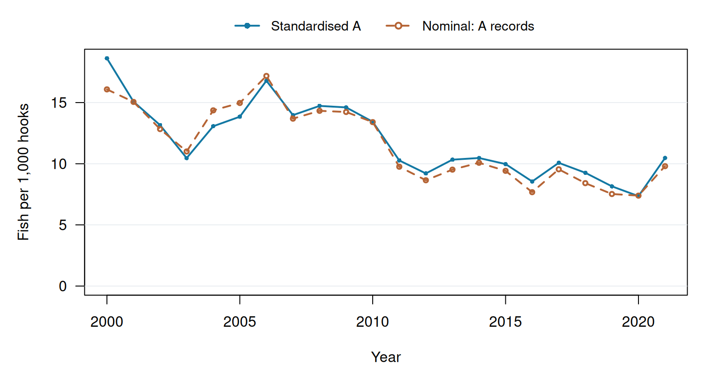
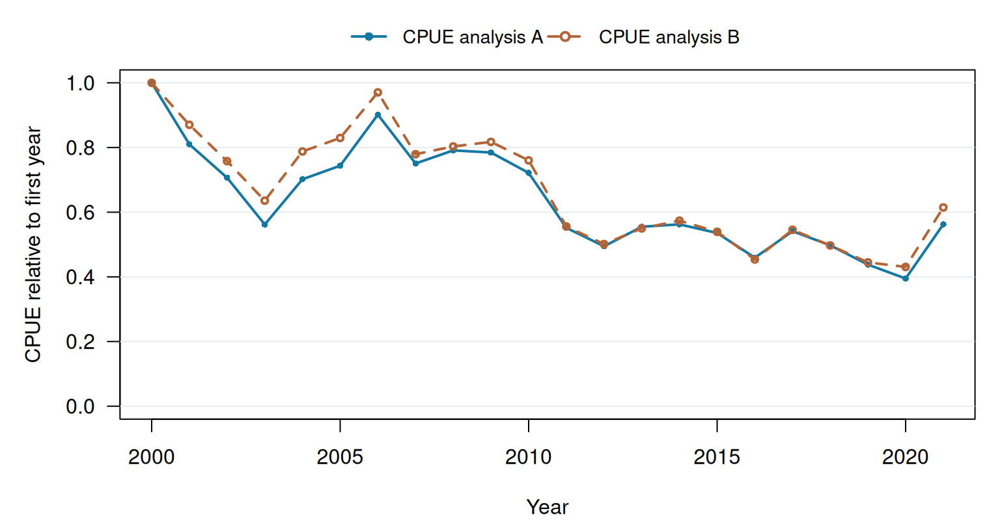

See how standardisation changes annual CPUE, then compare the two saved relative indices.

::: {.cell}

:::

## Standardised and nominal CPUE

::: {.cell}
::: {.cell-output-display}
{width=768}
:::
:::

Standardised A averages predictions at 1,000 hooks over the same 6 cell–quarter strata with equal weights each year. Nominal CPUE is 1,000 × annual total catch / annual total hooks from the same A records. Any A effort filter applies to both curves.

## Relative indices for analyses A and B

::: {.cell}
::: {.cell-output-display}
{width=768}
:::
:::

Each index is divided by its own first-year prediction (first year = 1). A adjusts cell–quarter composition; B adjusts quarter only on the same fixed prediction support. B may use different records because the optional effort filter applies to A.

## Methods and checks

The saved models are quasipoisson GLMs with a log link and a `log(hooks / 1000)` offset. A adjusts for cell–quarter composition; B adjusts quarter only; quarter effects partly confound spatial differences on this support. The source rows are fleet–cell–quarter aggregates, not individual fishing sets.

**A:** `catch_n ~ factor(year) + factor(stratum) + offset(log(hooks/1000))`

**B:** `catch_n ~ factor(year) + factor(quarter) + offset(log(hooks/1000))`

A effort threshold: **0 hooks per record** (0 retains all eligible records).

|Analysis | Rows used| Excluded|Converged |Score error | Dispersion|
|:--------|---------:|--------:|:---------|:-----------|----------:|
|A        |       132|        0|TRUE      |4.24e-13    |   1213.277|
|B        |       132|        0|TRUE      |1.33e-15    |   3011.218|

A's fixed prediction weights: `20S_170E_Q4` (0.1667); `20S_175E_Q1` (0.1667); `20S_175E_Q2` (0.1667); `20S_175E_Q3` (0.1667); `20S_175E_Q4` (0.1667); `25S_175E_Q3` (0.1667).

Score error is the maximum relative difference between fitted and observed annual, stratum or quarter catch totals. Dispersion is the Pearson sum of squares divided by residual degrees of freedom.

## Interpretation and limits

The first plot shows the effect of holding cell–quarter composition fixed for A's selected records. The index covers the selected fleet and released strata; vessel identifiers are unavailable. Released zero counts are retained, while absent or suppressed values are not zero catch. An effort filter may require model predictions for omitted year–stratum combinations. No confidence intervals are supplied, and this workflow example provides no stock-wide or official assessment advice.

## Analysis record

Produced in **Run 001** from preserved results; rendering fits no models. Annual values and the full method record are in **Data**. Producing runs, input checksums, code, settings and software are in **Inputs & versions** and the downloadable bundle.

[Calculation container](https://github.com/PacificCommunity/ofp-sam-docker-images/pkgs/container/fisheries-workflow) · [Source 6dc2b71b24c9](https://github.com/kyuhank/fisheries-workflow-demo/commit/6dc2b71b24c946b17f05c93fe4d7810e29c36d1e)
