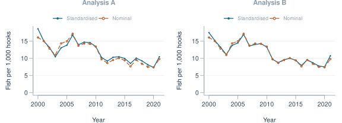
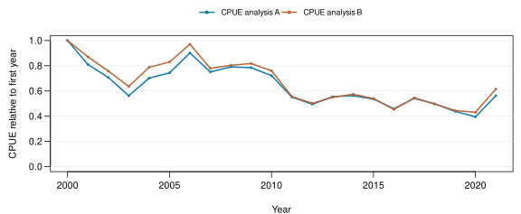

# CPUE analysis

Nominal = 1,000 × annual fish / annual hooks, using the same selected records as each standardised curve. Quasipoisson GLM: year + cell–quarter stratum; Quasipoisson GLM: year + quarter. Arithmetic mean of response-scale predictions with equal fixed stratum weights. 

## Relative indices

<table>
 <thead>
  <tr>
   <th style="text-align:left;"> Analysis </th>
   <th style="text-align:left;"> Rows </th>
   <th style="text-align:left;"> Excluded </th>
   <th style="text-align:left;"> Min hooks </th>
   <th style="text-align:left;"> Converged </th>
   <th style="text-align:left;"> Dispersion </th>
  </tr>
 </thead>
<tbody>
  <tr>
   <td style="text-align:left;"> A </td>
   <td style="text-align:left;"> 132 </td>
   <td style="text-align:left;"> 0 </td>
   <td style="text-align:left;"> 0 </td>
   <td style="text-align:left;"> Yes </td>
   <td style="text-align:left;"> 1213 </td>
  </tr>
  <tr>
   <td style="text-align:left;"> B </td>
   <td style="text-align:left;"> 132 </td>
   <td style="text-align:left;"> 0 </td>
   <td style="text-align:left;"> 0 </td>
   <td style="text-align:left;"> Yes </td>
   <td style="text-align:left;"> 3011 </td>
  </tr>
</tbody>
</table>

Each index is scaled to its own first year (= 1). Dispersion is the Pearson residual sum of squares / residual df.

**Scope:** Fiji fleet; six observed cell–quarter strata, 2000–2022. Fleet–cell–quarter aggregates; vessel effects and confidence intervals are unavailable. Released zeros are retained; absent/suppressed values are excluded.

---

Run `001`. [Data & full record](report-data.json) · [Code d4454fcf](https://github.com/kyuhank/fisheries-workflow-cpue-demo/commit/d4454fcfa9a23bd590344ad92940a13fa0a41c06) · [Workflow 9cb9e72e](https://github.com/kyuhank/fisheries-workflow-demo/commit/9cb9e72ec890e86e1f268a23d829e7c2ab8bde93) · Image 9dea950a713b.

Data: WCPFC/SPC public statistics. [Source 1](https://www.wcpfc.int/sites/default/files/2026-04/WCPFC_L_PUBLIC_BY_YY_QTR_FLAG.zip) · [Source 2](https://www.wcpfc.int/sites/default/files/2026-03/YB_WCPFC_2026-02-25.zip).
