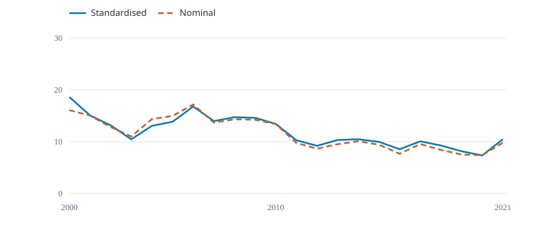
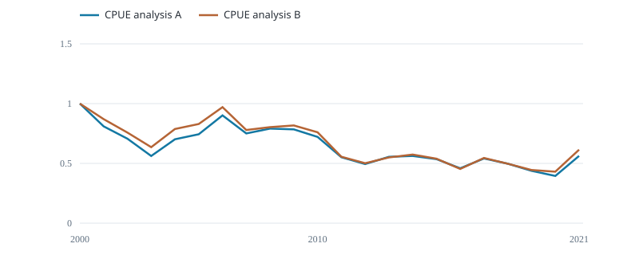

# Compare CPUE results

Fiji longline albacore · 2000--2021 · 132 released records used by A.

::::: plot-pair
::: section
## Standardised and nominal CPUE

{fig-alt="Fish per 1,000 hooks"}

Fish per 1,000 hooks
:::

::: section
## Relative indices A and B

{fig-alt="Each index relative to its own first year"}

Each index relative to its own first year
:::
:::::

Both curves use the same selected rows; 132 used, 0 excluded; no additional effort filter.

The first plot uses the same A records for both curves. Any A effort filter applies to both; B uses its own eligible records.

Standardised: Arithmetic mean of response-scale predictions with equal fixed stratum weights. Nominal: 1,000 × annual fish numbers / annual hooks on the A rows.

A predicts catch at 1,000 hooks in each of six fixed cell--quarter strata and averages with equal weights. B adjusts quarter only on that support. The local fleet index has no supplied confidence intervals and has not been validated for stock-wide abundance.

The A/B comparison includes differences in adjustment and row selection. Each relative index equals one in its own first year.
