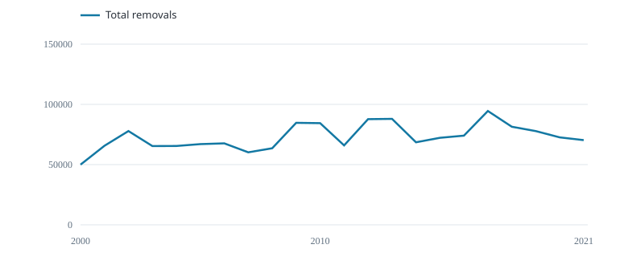

# Prepare and load

639 records · 79 cell--quarter strata · 2000--2021.

{fig-alt="Total annual catch (tonnes)"}

Total annual catch (tonnes)

Annual removals are saved separately from catch numbers in the CPUE rows.

## Sample of annual coverage

  Year   Records   Hooks      Fish (number)   Total catch (t)
  ------ --------- ---------- --------------- -----------------
  2000   15        17411790   308821          49980
  2001   18        24628386   420309          65636
  2002   24        29038337   434332          77856
  2003   23        33041314   361225          65395
  2004   29        46209869   634654          65470
  2005   25        39048167   665272          67016
