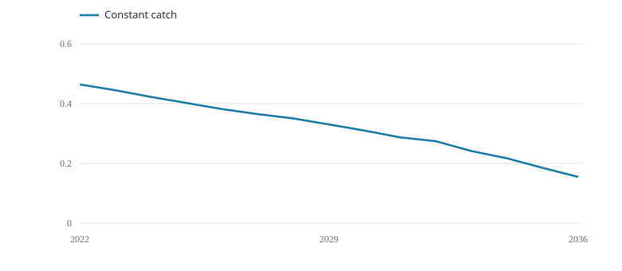

# Constant catch

Keep catch at its recent mean.

::::: plot-pair
::: section
## Biomass across trials

{fig-alt="Median end-of-year B / K"}

Median end-of-year B / K
:::

::: section
## Realised catch across trials

{fig-alt="Median annual catch (tonnes)"}

Median annual catch (tonnes)
:::
:::::

These medians combine the declared stock cases and growth scenarios with equal weight; they are conditional examples.

::: table-scroll
  Management rule   Mean catch (t/year)   Final B / K   Trials below 0.2 (%)   Catch change (%)
  ----------------- --------------------- ------------- ---------------------- ------------------
  Constant catch    6.987e+04             0.1548        57.5                   1.769
:::

Final biomass is the median across trials. The threshold column counts trials that fell below 0.2 of carrying capacity at any time; 0.2 is an illustrative comparison level. Catch change is annual absolute change relative to mean catch, including the first change from recent catch. Cases and scenarios have equal weight, not estimated probabilities.

Each year: observe the index, set catch, then update the stock.

The selected Fiji fleet index is not a validated stock-wide abundance index. Using it with stock-wide catches is a teaching assumption.

The shared guardrail caps realised catch at 40% of true starting biomass. Biomass and low-biomass statistics are conditional on that safeguard.

Some requested catches exceeded the simulated harvest limit; metrics use realised catch.
