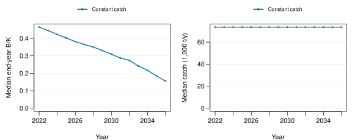

# Constant catch

Keep catch at its recent mean. 

<table>
 <thead>
  <tr>
   <th style="text-align:left;"> Rule </th>
   <th style="text-align:left;"> Catch (t/y) </th>
   <th style="text-align:left;"> Final B/K </th>
   <th style="text-align:left;"> Below 0.2 (%) </th>
   <th style="text-align:left;"> Catch change (%) </th>
   <th style="text-align:left;"> Capped trials </th>
  </tr>
 </thead>
<tbody>
  <tr>
   <td style="text-align:left;"> Constant catch </td>
   <td style="text-align:left;"> 69870 </td>
   <td style="text-align:left;"> 0.1548 </td>
   <td style="text-align:left;"> 57.5 </td>
   <td style="text-align:left;"> 1.769 </td>
   <td style="text-align:left;"> 79 </td>
  </tr>
</tbody>
</table>

Catch is the trial mean; final B/K is the trial median. Below-threshold means any year. Catch change includes the first change from reference catch; capped trials requested more than the guardrail allowed.

15 years; 20 trials per case/scenario. Realised catch ≤ 40% of true starting biomass. Equal case/scenario weights; all comparisons are conditional on the shared guardrail. Toy lognormal errors and fixed fitted cases provide illustrative trial fractions, not calibrated risk.

**Scope:** selected Fiji fleet index with stock-wide catches is a teaching assumption; the index is not validated as stock-wide abundance.

---

Run `001`. [Data & full record](report-data.json) · [Code 7ae67f11](https://github.com/kyuhank/fisheries-workflow-mse-demo/commit/7ae67f11217ef10ba8f4fb3a52707707377c1f32) · [Workflow 9cb9e72e](https://github.com/kyuhank/fisheries-workflow-demo/commit/9cb9e72ec890e86e1f268a23d829e7c2ab8bde93) · Image 9dea950a713b.

Data: WCPFC/SPC public statistics. [Source 1](https://www.wcpfc.int/sites/default/files/2026-04/WCPFC_L_PUBLIC_BY_YY_QTR_FLAG.zip) · [Source 2](https://www.wcpfc.int/sites/default/files/2026-03/YB_WCPFC_2026-02-25.zip).
