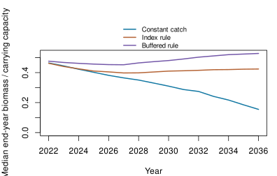
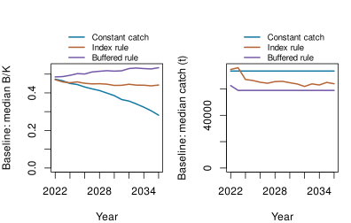
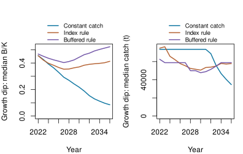

Compare catch, biomass and catch stability for three rules under the same simulated future conditions.

**Path:** Four fitted cases → shared trials and catch rules → management comparison.

::: {.cell}

:::

## Management comparison

::: {.cell}
::: {.cell-output-display}

:::
:::

Compare biomass alongside realised catch and annual catch changes. These
conditional trials provide neither calibrated risk estimates nor evidence that
a rule would be safe without the shared harvest guardrail. Fixed case differences
do not include assessment parameter uncertainty or select a rule for a real fishery.

Some requested catches exceeded the harvest guardrail. Metrics use realised catches.

### Catch, biomass and catch stability

::: {.cell}
::: {.cell-output-display}

|Rule           | Mean catch (t/year)| Final B/K| Trials below 0.2 (%)| Catch change (%)|
|:--------------|-------------------:|---------:|--------------------:|----------------:|
|Constant catch |            69874.22|     0.155|                 57.5|            1.769|
|Index rule     |            62659.38|     0.424|                  0.0|            6.707|
|Buffered rule  |            57497.83|     0.528|                  0.0|            6.388|

:::
:::

Mean catch is in tonnes per year; final B/K is the median across trials. The
threshold column counts trials below 0.2
of carrying capacity at any time. Catch change averages each trial's `100 × sum(abs(C_t − C_(t−1))) / sum(C_t)` using realised catches,
including the first change from the reference catch. Cases and scenarios have equal weight, not estimated probabilities.

### Trajectories by growth scenario

::: {.cell}
::: {.cell-output-display}

:::

::: {.cell-output-display}

:::
:::

### Trial assumptions and limits

One scenario keeps the growth multiplier at one. The other uses 0.7 for six
years, then returns to one. Mean-one lognormal growth and observation errors
have coefficients of variation 0.2 and
0.15 before the growth cap is applied. The
preparation result preserves seeds, RNG settings and actual paired error vectors.
Surplus production uses starting biomass; realised catch is then removed.

- Fixed growth sensitivities and initial biomass; fitted cases are not weighted probabilities.
- Growth and observation errors are declared toy lognormal perturbations.
- No assessment is refitted during these management trials.
- Empirical trial fractions are conditional illustrations, not validated risk estimates.
- Annual growth is capped at one to retain the simple Euler update within its stable range.

## Methods

**Source coverage:** Fiji fleet; six observed cell–quarter strata, 2000–2022. **Annual catch:** South Pacific albacore nominal catch estimates; all gears and fleets.

The selected Fiji fleet index is not a validated stock-wide abundance index. Using it with stock-wide catches is a teaching assumption.

Four fitted Schaefer cases supply starting biomass, capacity, growth and
catchability. Constant catch, an index rule and a buffered rule use the same
saved growth and observation errors for **15 years**,
with **20 trials** per case and scenario.
Each year, observe an index → set catch → update biomass → observe again.
The index rules use a three-year observed mean. Reference catch C₀ and index
I₀ are the last three historical-year means. Rₜ is the mean of the current
simulated index and previous two indices, divided by I₀.

| Rule | Requested catch |
|:--|:--|
| Constant | C₀ |
| Index | C₀ × min(2, Rₜ) |
| Buffered | b × C₀ × m(Rₜ), limited to ±15% of the previous request (initially C₀) |

Here b is 0.8. The step multiplier m is
0.5, 1, 1.25
for Rₜ below 0.8, between
0.8 and 1.1,
or at least 1.1, respectively.

**Shared guardrail:** realised catch is capped at
40% of true starting biomass.
This simulator safeguard uses biomass unavailable to the index rules; every
rule's biomass and low-biomass statistics are conditional on that guardrail.
Growth is capped at 1 per year.

## Analysis record

Produced in **Run 001**. Retained inputs keep their original producing runs.

Execution: Local Docker.

Calculation image: `sha256:9dea950a713b…` (full digest in the run bundle).

[Container package](https://github.com/PacificCommunity/ofp-sam-docker-images/pkgs/container/fisheries-workflow)

[Coordinator source at b343d9d1](https://github.com/kyuhank/fisheries-workflow-demo/commit/b343d9d1c704cfe5f3c4fe61ccef1ae3e679e406)

[MSE component source at 24c47d6f](https://github.com/kyuhank/fisheries-workflow-mse-demo/commit/24c47d6f755f390f9e1865d7ec762d87d796937d)

Annual values are available in the **Data** tab. Input files, settings, source versions and checksums are available in **Inputs & versions** and the downloaded run. Rendering reads saved results and does not fit models again.
