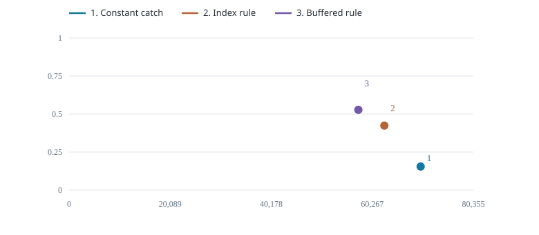
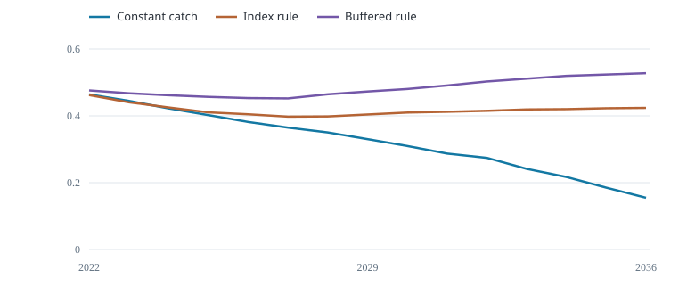

# MSE results summary

Compare catch, stock condition and catch stability under the same trials.

::::: plot-pair
::: section
## Catch and final biomass

{fig-alt="Management trade-off: mean annual catch (tonnes) and median final biomass / carrying capacity"}

Mean annual realised catch (tonnes); y: median final B / K
:::

::: section
## Biomass through time

{fig-alt="Median end-of-year B / K"}

Median end-of-year B / K
:::
:::::

Each point is one rule's saved mean catch and median final biomass. The comparison shows trade-offs and does not rank the rules.

::: table-scroll
  Management rule   Mean catch (t/year)   Final B / K   Trials below 0.2 (%)   Catch change (%)
  ----------------- --------------------- ------------- ---------------------- ------------------
  Constant catch    6.987e+04             0.1548        57.5                   1.769
  Index rule        6.266e+04             0.4239        0                      6.707
  Buffered rule     5.75e+04              0.5276        0                      6.388
:::

Final biomass is the median across trials. The threshold column counts trials that fell below 0.2 of carrying capacity at any time; 0.2 is an illustrative comparison level. Catch change is annual absolute change relative to mean catch, including the first change from recent catch. Cases and scenarios have equal weight, not estimated probabilities.

The selected Fiji fleet index is not a validated stock-wide abundance index. Using it with stock-wide catches is a teaching assumption.

The shared guardrail caps realised catch at 40% of true starting biomass. Biomass and low-biomass statistics are conditional on that safeguard.

Some requested catches exceeded the simulated harvest limit; metrics use realised catch.
