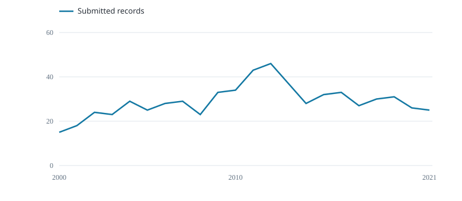

# Data submission

639 submitted public aggregate records · 2000--2021.

{fig-alt="Records per year"}

Records per year

## Sample of submitted rows

  Record               Year   Fleet   Cell       Quarter   Hooks     Fish (number)
  -------------------- ------ ------- ---------- --------- --------- ---------------
  wcpfc_ll_row_44348   2000   FJ      15S_175E   1         539205    9159
  wcpfc_ll_row_44349   2000   FJ      20S_170E   1         497154    10770
  wcpfc_ll_row_44350   2000   FJ      20S_175E   1         2885989   37424
  wcpfc_ll_row_44655   2000   FJ      15S_175E   2         1067388   21140
  wcpfc_ll_row_44656   2000   FJ      20S_170E   2         891215    26606
  wcpfc_ll_row_44657   2000   FJ      20S_175E   2         2751718   51152

Each row combines fleet, five-degree cell, quarter and year; vessel IDs are unavailable.

First six rows shown.
